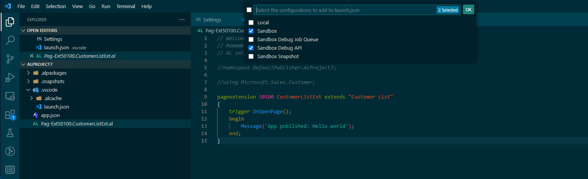
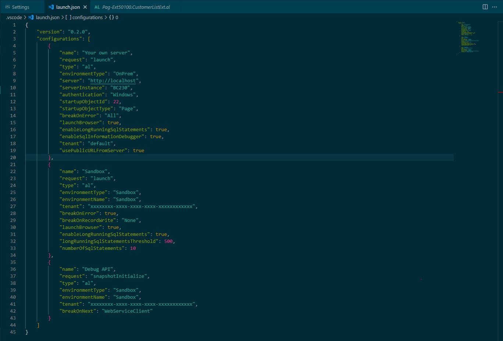
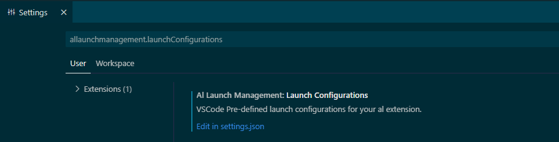
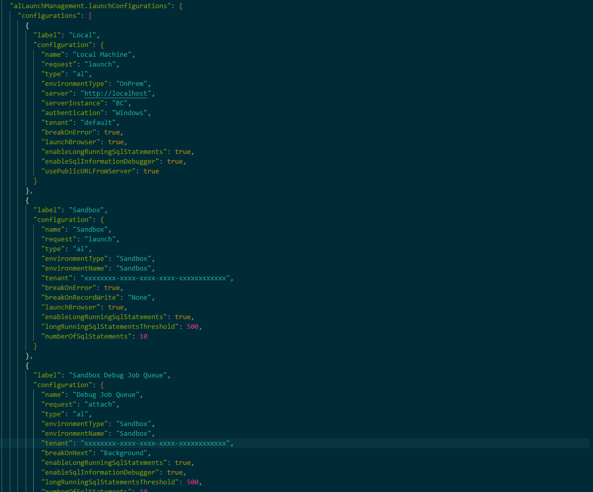
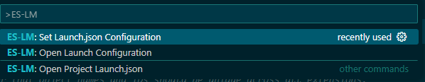

#

<p align="center">
  
  <h1 align="center">AL Launch Management</h1>
</p>

<p align="center">
  <a href="https://github.com/edyspider/ALLaunchManagement/blob/main/LICENSE">
    
  </a>
  <a href="https://marketplace.visualstudio.com/items?itemName=EdySpider.allaunchmanagement">
    
  </a>
  <a href="https://marketplace.visualstudio.com/items?itemName=EdySpider.allaunchmanagement">
    
  </a>
  <a href="https://github.com/edyspider/ALLaunchManagement/tags">
    
  </a>
  <a href="https://github.com/edyspider/ALLaunchManagement/actions/workflows/ci.yml">
    
  </a>
  <a href="https://github.com/edyspider/ALLaunchManagement/issues">
    
  </a>
</p>

## Features

This extension allows you to add pre-configured `launch.json` configurations to
your AL projects, to minimize the time spent setting up the configurations every
time you create or add new projects to your workspace.

- Pick one or more pre-defined configurations from a list.
- A configuration with the same `name` as one already in `launch.json` replaces
it instead of being duplicated.
- Works with a single folder and with multi-root workspaces: it uses the folder of
the active file, or asks you to pick one.





---

## Requirements

- `Dynamics 365 Business Central`.
- `Visual Studio Code`.
- `AL Language Extension for VSCode`.

---

## Extension Settings

This extension contributes the following settings:

- `alLaunchManagement.launchConfigurations`:
  - This setting allows you to define multiple `launch.json` configurations. Each
  item of `configurations` has a `label` (shown in the selection list) and a
  `configuration` (copied to `launch.json`), for example:

```json
"alLaunchManagement.launchConfigurations": {
  "configurations": [
    {
      "label": "Sandbox",
      "configuration": {
        "name": "Sandbox",
        "type": "al",
        "request": "launch",
        "environmentType": "Sandbox",
        "environmentName": "Sandbox",
        "tenant": "xxxxxxxx-xxxx-xxxx-xxxx-xxxxxxxxxxxx"
      }
    }
  ]
}
```





---

## Extension Commands

This extension contributes the following commands:

- `ES-LM: Set Launch.json Configuration`:
  - This command adds the selected pre-defined configurations to the `launch.json`
  file of your project.
- `ES-LM: Open Launch Configuration`:
  - This command opens the settings of this extension.
- `ES-LM: Open Project Launch.json`:
  - This command opens the `launch.json` file of the current project.



---

## Known Issues

See the [open issues](https://github.com/edyspider/ALLaunchManagement/issues)
on GitHub.

---

## Release Notes

### [1.4.0]

- A configuration with the same name is replaced instead of duplicated ([#2](https://github.com/edyspider/ALLaunchManagement/issues/2)).
- Configurations from your user settings are no longer copied to the project.
- Clear messages when no folder is open, nothing is selected or saving fails.
- IntelliSense and validation for the extension settings.
- Fixed the "Sandbox Debug API" default configuration (`attach`).
- Requires VS Code 1.95 or later.

See the [CHANGELOG](CHANGELOG.md) for all versions.

---

## Authors

- [**EdySpider**](https://github.com/edyspider/)

---

## License

- **[MIT license](https://github.com/edyspider/ALLaunchManagement/blob/main/LICENSE)**
- Copyright 2024-2026 &copy; [EdySpider](https://github.com/edyspider).
